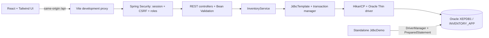
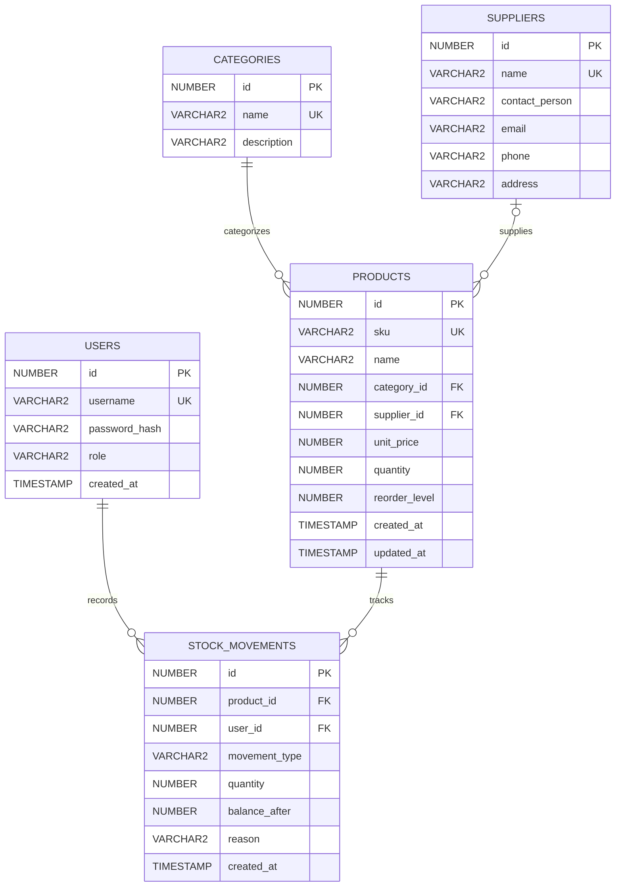

# Architecture

Login uses Spring Security's authentication filter and BCrypt-backed UserDetailsService querying Oracle. Success creates/rotates the session; the frontend then fetches a new CSRF token and session identity. Reloading the page restores identity from `/auth/me`. Logout invalidates the session. Routes are gated by identity in React and independently protected by Spring Security and method authorization.

The service layer owns transactions. The database is the authority for IDs, constraints and balances. Product lists and stock history are paginated. Search uses bound parameters and escapes LIKE wildcards; sort names/directions are allowlisted before composing SQL. Reports are read-only SQL projections, exported with spreadsheet-formula escaping. Database errors are translated to meaningful HTTP errors without exposing raw SQL or credentials.
