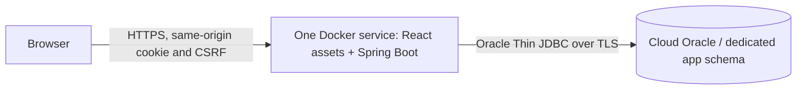

# Deployment readiness and production configuration

Prepared 19 October 2026. No cloud resources, GitHub commits, pushes or deployments were made during QA.

## Recommended architecture for this lab

Use one paid Docker web service on Render to serve the React production build and Spring Boot API under the **same HTTPS origin**. Use an Oracle Cloud Autonomous Database with a dedicated application schema, connected with the official Oracle Thin JDBC driver. Retain one app instance initially because sessions live in that JVM.



This avoids a separate frontend bill and cross-site cookie dependencies. It preserves Oracle SQL, JDBC, JdbcTemplate and transactions. Render does not need to host Oracle itself. A cloud app cannot reach the Oracle listener at `localhost` on your laptop; that hostname would refer to the cloud container. Do not expose the laptop's listener publicly as the deployment strategy.

For a small lab demonstration, a Render Starter web service is listed at **US$7/month for 512 MB**, before applicable taxes, bandwidth or other charges. This is a starting budget, not a memory/load guarantee; monitor JVM use and upgrade if necessary. A paid service avoids the idle spin-down of free Render services. Verify prices before purchasing: [Render pricing](https://render.com/pricing), [free instance behavior](https://render.com/docs/free).

Oracle Always Free Autonomous Database can keep lab database charges at zero if your tenancy/region has capacity and you stay eligible. It is **not equivalent to a reliable production database plan**: Oracle documents session limits, automatic inactivity stoppage and lack of point-in-time restore on Always Free. Keep approved exports for the lab, and use a paid database/backup plan for records you cannot afford to lose. See [Oracle Always Free restrictions](https://docs.oracle.com/en/cloud/paas/autonomous-database/serverless/adbsb/autonomous-always-free.html). Cloud enrollment/capacity and a tested backup/recovery plan remain prerequisites.

## Prepared build paths

The root Dockerfile builds React, copies its assets into Spring Boot, and runs the JAR as a non-root user. `.dockerignore` excludes secrets, wallets and local build/tool folders. The image has **not been built here** because Docker is not installed; Docker build and runtime smoke tests are still a release gate.

The equivalent combined JAR was built and HTTP-tested locally with the Maven production profile:

```powershell
cd frontend
npm.cmd ci
npm.cmd test
npm.cmd run build
cd ..
# With Java 21 and Maven on PATH, or using the portable Maven path:
mvn.cmd -f backend/pom.xml -Pproduction clean package
```

`-Pproduction` copies `frontend/dist` into the JAR. Build the frontend first; otherwise this profile cannot include its assets. The Dockerfile performs that ordering automatically. `/`, `/index.html` and `/assets/**` are public; protected APIs remain authenticated. The frontend uses state-based navigation, so it currently does not need arbitrary SPA history fallback routes.

After Docker installation, validation commands (not a deployment) are:

```powershell
docker build -t inventorypro:qa .
```

Run the image against an isolated Oracle staging schema using credentials entered locally or managed by your hosting secret store. Never bake DB credentials into image build arguments. Test `/`, `/api/health`, login, logout, CSRF, stock operations and secure cookies over HTTPS before release. Do not point automated mutation tests at your existing local or production schema.

## Production environment variables

| Variable | Scope | Production setting |
| --- | --- | --- |
| DB_URL | Backend runtime, optional override | Full Oracle Thin URL supplied by your database provider; recommended for TLS descriptors. Overrides DB_HOST/PORT/SERVICE. |
| DB_HOST | Backend runtime | Remote database hostname when DB_URL is unset. |
| DB_PORT | Backend runtime | Provider's database port; do not assume local 1521 for TLS. |
| DB_SERVICE | Backend runtime | Provider's service name, not an assumed XEPDB1. |
| DB_USERNAME | Backend runtime | Dedicated cloud application schema; never SYS/SYSTEM/ADMIN for normal operation. |
| DB_PASSWORD | Secret runtime variable | Cloud application DB password, no default; hosting secret store only. |
| PORT | Backend runtime | Hosting-provided port, default 8080 locally. |
| SESSION_COOKIE_SECURE | Backend runtime | `true` (default). Use false only for local HTTP tests. |
| FORWARD_HEADERS_STRATEGY | Backend runtime | `framework` behind the hosting HTTPS proxy. Restrict direct backend access to trusted proxy paths. |
| FRONTEND_ORIGINS | Backend runtime | Empty for the recommended same-origin deployment. Optional comma-separated exact HTTP(S) origins for an explicitly selected split-origin architecture; no paths, trailing slashes or wildcards. |
| VITE_API_BASE_URL | Frontend **build time**, public | `/api` for the recommended deployment. Can be a root-relative prefix or absolute HTTP(S) API URL including `/api`; rebuild frontend after changes. Used for API calls and CSV downloads. Never put a secret here. |
| SPRING_PROFILES_ACTIVE | Backend runtime | Leave the dev initializer profile off during normal production operation. |
| DEV_ADMIN_USERNAME / DEV_ADMIN_PASSWORD | Bootstrap only | Do not keep enabled in production; see below. |

Example full URL for a regular remote Oracle listener: `jdbc:oracle:thin:@//db.example.invalid:1521/service_name`. For Autonomous, copy its actual **TLS JDBC connection descriptor** into DB_URL. Do not weaken certificate validation. Oracle documents TLS and mTLS options: [Oracle Thin JDBC connection guidance](https://docs.oracle.com/en/cloud/paas/autonomous-database/serverless/adbsb/connect-jdbc-thin.html). Walletless TLS is the simpler candidate when enabled by the provider/network policy. Wallet-based mTLS needs separately mounted secrets and potentially additional Oracle security libraries/configuration; it is **not configured or cloud-tested by this QA run**.

The existing split-origin option sends credentialed requests and permits only explicitly configured origins. SameSite=Lax cookies still prevent reliable authentication across unrelated sites. Prefer same-origin hosting; an absolute API URL alone is not a complete cross-site session deployment solution.

## Database provisioning and bootstrap

1. Obtain approval for the cloud account, spending limits, region and database plan.
2. Create a **new** cloud/staging Oracle schema using that provider's administrator workflow. `00_create_user.sql` is specific to local XE/XEPDB1/USERS tablespace; do not run it blindly on Autonomous. Its tablespace and privileges need provider-specific adaptation.
3. Apply `01_schema.sql` once to the new dedicated cloud schema. Optional `02_seed.sql` only supplies categories. Nothing should overwrite your existing laptop data. Any export/import of existing records requires a separate approved migration plan and backup.
4. Configure DB_URL/credentials and restrict the Oracle network ACL to the hosting service's documented outbound addresses, where supported. Validate TLS connectivity from staging.
5. For the first administrator, use a private/restricted staging service and a one-time dev-profile initializer with a newly generated admin credential in secret storage. Confirm login, then remove DEV_ADMIN_PASSWORD and the dev profile and restart. Alternatively implement an operator bootstrap procedure before exposure. Do not embed an initial password in SQL, Git, Dockerfile or Vite variables.
6. Confirm health, schema relationships, password hashing, HTTPS session cookies and CSRF in staging. Enable public access only after release gates below pass.

## Remaining release gates

- Finish real-browser tests at 390px, 768px and 1440px, light/dark, keyboard/modal focus, console errors and CSV downloads. Automation was unavailable during this audit.
- Build and smoke-test the Docker image. The combined JAR is tested, but the image itself is not.
- Provision a reachable cloud Oracle instance; test its actual TLS descriptor and network ACL. Local Oracle tests do not prove cloud connectivity.
- Add/verify login rate limiting and abuse protection at an upstream gateway/WAF before public internet exposure. The application does not currently implement account lockout or login throttling.
- Establish database backup/export retention and test recovery. Always Free is suitable for a lab budget, not guaranteed production recovery.
- Configure production admin bootstrap, HTTPS domain/certificates and secret management.
- Keep one instance initially, or add a shared session store/sticky routing before scaling; a restart invalidates sessions by design, while Oracle records persist.
- Set operational monitoring/alerting and verify memory under expected usage. No load/SLA claim is made by the functional QA suite.

## GitHub source publication

See [GitHub publishing guide](GITHUB.md) for staging, review, remote, and upload steps. Repository visibility and the initial push require a separate explicit decision. The public source repository contains no Oracle data, passwords, or wallet.

Only after explicit deployment approval: connect the selected repository to the hosting provider, choose root Dockerfile, set environment secrets and health-check path `/api/health`, select the paid plan/region, deploy to staging, run smoke tests against the new cloud schema, and promote after review. This audit creates no resources and uploads no source or data.
